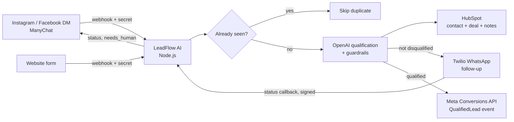

# LeadFlow AI

From a Meta ad enquiry to a qualified lead in HubSpot, automatically.

A lead comes in from **ManyChat** (Instagram / Facebook DMs) or a **website form**. LeadFlow AI qualifies it with **OpenAI**, creates or updates the **HubSpot** contact and deal, sends a **Twilio WhatsApp** follow-up, and reports qualified leads back to **Meta Conversions API** so ads optimise for leads that actually convert.

Zero dependencies: plain Node.js 22 + TypeScript, `node:http`, `fetch` and `node:test`.



## What it handles

| Concern | How |
|---|---|
| Duplicate webhooks and double submits | Idempotency key per lead (`mc_<subscriber_id>`, `form_<submission_id>`) |
| Flaky APIs | Retries with exponential backoff on network errors, 429 and 5xx; fails fast on other 4xx |
| One service down | Each step (HubSpot, Twilio, CAPI) runs on its own; errors are recorded, the rest still run |
| Bad AI output | Strict JSON schema check; on failure, rule-based score and the lead is flagged `needs_human` |
| Human handoff | ManyChat gets `needs_human` back and can route the chat to a person |
| Fake webhook calls | Shared secret for ManyChat / form; HMAC-SHA1 signature check for Twilio callbacks |
| Privacy for Meta | Email, phone and names are SHA-256 hashed before being sent to CAPI |
| Delivery monitoring | Twilio status callback logs `failed` / `undelivered` messages |

## Run it

```bash
cp .env.example .env      # DRY_RUN=true logs every outbound call instead of sending it
npm start                 # http://localhost:3000
npm test                  # 12 tests, all external APIs mocked
```

Try a lead (dry run):

```bash
curl -X POST localhost:3000/webhooks/form \
  -H 'content-type: application/json' \
  -d @examples/web-form-lead.json
```

## Endpoints

| Method | Path | Used by |
|---|---|---|
| GET | `/health` | Uptime checks |
| POST | `/webhooks/manychat` | ManyChat "External Request" action |
| POST | `/webhooks/form` | Website enquiry form |
| POST | `/webhooks/twilio/status` | Twilio message status callback |

## Connect the real services

1. **HubSpot**: create a private app with `crm.objects.contacts.write` and `crm.objects.deals.write`, then add these contact properties: `lead_source_channel`, `ai_qualification_status`, `ai_qualification_score`, `ai_qualification_reason`, `needs_human`. Put your pipeline and stage ids in `.env`.
2. **ManyChat**: in your Instagram / Facebook flow, after the qualification questions add an **External Request** to `POST /webhooks/manychat` with header `X-Webhook-Secret`, and the body from `examples/manychat-lead.json`. Map the response field `needs_human` to a condition that hands the chat to Live Chat.
3. **Twilio**: use the WhatsApp sandbox number for testing (`whatsapp:+14155238886`). Set `PUBLIC_BASE_URL` so the status callback can reach you.
4. **Meta CAPI**: add your Pixel id and a system user access token. Use `META_TEST_EVENT_CODE` to see events in Events Manager > Test events before going live.
5. Set `DRY_RUN=false`.

## Project layout

```
src/
  server.ts          HTTP routes and webhook security
  pipeline.ts        The flow for one lead
  config.ts          Environment settings
  lib/
    normalize.ts     ManyChat / form payload -> one Lead shape, E.164 phones
    qualify.ts       OpenAI qualification + guardrails + rule-based fallback
    hubspot.ts       Contact upsert, deal in the right stage, timeline notes
    twilio.ts        WhatsApp send, signature verification, message copy
    metaCapi.ts      Hashed Conversions API events
    http.ts          fetch with timeout and retries
    store.ts         Idempotency and audit log (JSON file; swap for Postgres/Redis)
test/                node:test suite with mocked APIs
```

## Roadmap

- [ ] Google Ads offline conversion upload for qualified leads (`gclid`)
- [ ] AI voice agent on Twilio Voice + ElevenLabs, transcript saved to HubSpot
- [ ] Postgres store and a small dashboard of leads by source and status
